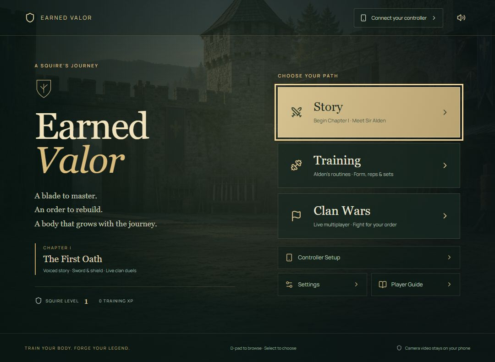

# Earned Valor

*Train your body. Forge your legend.*

A medieval fitness adventure for Fire TV, powered by an Android phone camera. **Earned Valor** includes **Chapter I: The First Oath**, a complete story path in a first-person 3D courtyard: a stormy opening memory, staged conversations and choices, three weapon lessons, Mara's trial, Tomas's forge, the Orders board and a letter that sends you toward Ironbridge. Five synthetic cast voices, original music, ambience and effects play from local audio assets. **Alden’s training hall** is available directly from the main menu, chapter title, header and pause menu, with calibrated squat/push-up routines, counted reps and sets, rest, voice cues and exercise-driven story stats. **The Orders** now supports live clan wars with 1–3 champions per clan, human-versus-human duels and a shared clan score. An illustrated first-visit tutorial explains setup, combat, story, training and multiplayer, with contextual replay buttons. The root page is now the medieval main menu: Story, Training, Clan Wars, Controller Setup, Settings and Player Guide. The older Orbit Arena and Reach & Reset demo screens have been removed.

The TV runs a native Android/Fire OS APK with a landscape WebView, D-pad navigation, Select/Back/Play-Pause support, and a Leanback launcher. The phone runs MediaPipe Pose Landmarker locally in Chrome. A small Node server serves both interfaces and relays landmarks over WebSockets. A TV camera is not required.

## Run on this computer

Node 22.12+ is required. Install dependencies with npm; the phone pose model is included and the matching MediaPipe runtime is prepared during installation. Android SDK and Java setup is described below.

~~~powershell
cd D:\ALEXA+
npm install
npm run dev
~~~

Open **http://localhost:8787/** for the main menu. Choose **Story** for Chapter I, **Training** for Alden’s routines, or **Clan Wars** for multiplayer. **Controller Setup** contains Android pairing, movement calibration and the labelled desktop preview. **Settings** saves sound and auto-dialogue preferences. Story, training and multiplayer can also open directly at `/chapter`, `/training` and `/arena`; navigation and browser Back keep the URL in sync. **Continue** resumes the saved quest checkpoint.

In the courtyard, **WASD** walks, **Left/Right arrows** turn, mouse dragging looks around, and **E** interacts. Each objective also offers a guided walk. During weapon lessons and the trial, **J / K / L** simulate cuts in different directions; mouse movement also places the sword hand. Hold **Shift + Z / X / C** to cover the left / high / right line, and **A / D** to lean. **W / S** advance or retreat in combat; hold **V** to crouch in the preview. **Space** pauses, **Q** opens the journal, and **Escape/Back** opens or closes menus. Camera tracking is off in desktop preview. On the phone controller, raise the left hand for a second to walk/interact/continue; lean to select a dialogue choice and return to centre before another selection.

Both duelists have **100 health**. The sword hilt follows the right wrist and its blade direction follows the right forearm; the shield follows the left wrist. Damage follows a validated sweep of the rendered sword tip. Cover the incoming high, left or right line, or evade after Mara commits. A late guard earns a stronger riposte; attacking a covered line is parried. Lowering the shield restores stamina, equipment changes reach and stamina costs, and distance can make a cut fall short. Three strikes cannot end a fresh trial.

Conversations advance when the voice finishes; choices always wait. Turn **Auto dialogue** off to read at your own pace. Audio settings provide separate voice, music and effects levels. Pausing or opening a menu stops dialogue, music and movement. Captions remain usable with sound off.

Production mode:

~~~powershell
npm run build
npm start
~~~

Do not run production and development servers on the same ports simultaneously. Configuration is optional: copy .env.example to .env to override ports or PHONE_BASE_URL.

## Run the Fire TV app

The current debug APK is **artifacts/EarnedValor-debug.apk**.

~~~powershell
npm run android:build
npm run android:run
~~~

The emulator helper enables OpenGL ES 3 with **host** graphics and `GLESDynamicVersion`, required by the 3D renderer. It forwards port 8787 through ADB and opens http://127.0.0.1:8787 to reach the server on this PC. The server must remain running. To launch the chapter directly, pass `-ServerUrl http://127.0.0.1:8787/chapter` to scripts/run-emulator.ps1. For a physical Fire TV, install the APK with adb and provide your PC's LAN server address:

~~~powershell
adb -s DEVICE_SERIAL install -r artifacts/EarnedValor-debug.apk
adb -s DEVICE_SERIAL shell am start -n dev.moveroom.tv/.MainActivity --es server http://YOUR_PC_IP:8787
~~~

Remote controls: D-pad browses menus; Select chooses, continues dialogue or opens the on-screen keyboard for fighter names, clan names and invite codes. In courtyard exploration, up/down walks and left/right turns while the 3D view is focused; Select interacts or starts a guided walk. Back opens the story pause menu or returns from a menu, and exits the native app only from the main menu. Play/Pause or Menu pauses an activity. In the debug APK, hold Menu to change the server address. Volume sliders use left/right to adjust and up/down to browse. The native wrapper targets the focused control and forwards key-down and key-up so walking stops on release. Sword fighting and exercise reps use the paired phone camera; desktop keyboard combat is a labelled demo option.

Graphics default to a **1920×1080** 3D buffer on a Full HD TV. **Settings → 3D resolution** switches between 1080p and a 1280×720 performance cap and saves the preference on this device. Display density is honored, including Android TV WebViews exposing a 960×540 CSS viewport at 2× density. The interface remains at the display's output resolution; smaller screens render at their available size. This follows [Amazon's 1080p web-app guidance](https://developer.amazon.com/docs/fire-tv/getting-started-with-web-apps.html#resolution-and-page-scaling). Frame rate still depends on hardware; physical Fire TV performance has not been measured.

The [hackathon FAQ](https://amazonappdev2026.devpost.com/details/faqs) accepts an Android TV Emulator for a Fire TV submission. The [Fire TV track requirements](https://amazonappdev2026.devpost.com/rules) require an app running on Fire OS or Vega; the supplied APK targets Fire OS/Android TV. This build does not target Vega OS.

## Connect your Android phone

**USB is the simplest local demo setup.**

1. Connect your Android phone by USB, enable USB debugging, and accept the phone's USB authorization prompt.
2. With the server running, run npm run phone:usb. This forwards port 8787 to the phone and opens http://localhost:8787/phone.
3. Open pairing on the TV and enter its six-character room code on the phone.
4. Tap Start my camera and allow Chrome camera access.
5. Prop the phone near the TV facing you. Keep both hands, shoulders, and hips visible.
6. Stay in view for three seconds; pairing continues automatically. Calibration begins after a five-second countdown in the selected standing/seated mode. Follow its four cues, then it returns to the game automatically. Choose **Keep setup open** or **Choose settings first** to take your time. After the camera has seen you, the manual buttons remain usable when you reach for the mouse; movement waits until you return to view.

USB uses localhost, a trusted camera context. It works with the Android TV emulator and avoids Wi-Fi certificate setup.

**Wi-Fi:** the TV QR code opens the HTTPS phone endpoint on port 8788. Both devices must reach this PC. The local server uses a self-signed development certificate, so Chrome may show a certificate warning that you must handle yourself. A trusted HTTPS deployment is needed for a frictionless wireless public demo. Plain HTTP on a LAN IP cannot access the phone camera.

Neither the server nor the TV receives camera video or audio. Only 33 pose landmarks and tracking timing travel to the TV. Coaching replay stores a bounded set of landmarks in TV memory, cleared when that screen is left. Calibration is saved locally on the TV.

## Verify

~~~powershell
npm test
npm run build
npm run android:build
~~~

The 112 automated tests cover calibrated/mirrored controls, wrist and sword-tip sweeps, independent hands and forearm orientation, dropouts, frame-rate consistency, coached holds and resets, and authenticated relay roles. Chapter checks cover dialogue branches and motive callbacks, checkpoint validation, collision-safe guided routes, all audio assets, health damage, directional guards and parries, perfect blocks and ripostes, stamina, timed evasion, combat reach, tracking/pause freezes, gear and once-only rewards. Eighteen training tests cover exercise views, calibration, complete rep cycles, sets/rest, visible corrections, personalization and bounded XP/stat rewards. Twenty-three multiplayer rule tests and a two-client WebSocket integration test cover human inputs, defenses, pause/dropout handling, health results, rosters and clan scoring. Additional edge tests exercise malformed/flooded relay traffic, replaced controllers, corrupted storage, overlapping pairing requests and expired wars. See the [edge-test report](artifacts/edge-test-report.md), [multiplayer and tutorial report](artifacts/multiplayer-tutorial-test-report.md) and [chapter test report](artifacts/story-adventure-test-report.md) for evidence and manual checks.

For recorded-input vision testing, run npm run test:vision:fixtures, then npm run build. Open http://localhost:8787/diagnostics and click Run recorded vision test. It checks a human image, 24 samples from a squat video, blank frames, and reacquisition using the phone's model and confidence settings. GPU and CPU can be tested separately. Fixtures have verified SHA-256 hashes and are ignored by Git; sources are listed in THIRD_PARTY.md.

The app has been tested in the Android TV emulator through pairing, calibration, a complete scored round, and lost/recovered tracking using a synthetic phone-landmark source. Desktop tests also completed calibration, five coached reaches, replay and restart. Both GPU and CPU passed recorded-human vision tests. **Actual phone camera access, live latency and physical play accuracy still need testing on your Android phone.** Tracking freshness automatically pauses play after missing frames; no tracking gap may create a sword strike or count as a coached hold.

To repeat the relay test without a phone, open TV pairing, then run node --import tsx scripts/relay-fixture.ts YOUR_TV_CODE in an interactive terminal. This explicitly uses synthetic landmarks at 18 fps, follows calibration cues, and generates wrist sweeps and shields. In the chapter trial it follows high/left/right wind-up cues to cover the correct line, then counterattacks. Type blank for no-person frames, freeze to stop sending packets, live to resume, or quit to disconnect. Choose an activity after attaching the fixture so it receives the TV's activity command. Keep this distinct from a real camera demo.

## Build elsewhere

Install Node 22.12+, Java 17, and an Android SDK with platform-tools, platforms;android-35, build-tools;34.0.0, emulator, and system-images;android-30;android-tv;x86. Set ANDROID_SDK_ROOT (or ANDROID_HOME) to the SDK and JAVA_HOME to Java 17.

The project includes the Gradle 8.9 wrapper. From android, run ./gradlew assembleDebug (Linux/macOS) or .\gradlew.bat assembleDebug (Windows). The Windows build helper copies the result into artifacts.

For the supplied Windows emulator helper, create a MoveRoomTV AVD using the Android 30 Android TV x86 image. It looks in .local/avd first and otherwise uses your standard Android AVD directory. Hardware virtualization/WHPX is needed for practical emulator performance.

npm install copies the MediaPipe WASM into public/vision and downloads the official lite pose model once. Run npm run assets if that download was interrupted. Model assets are served locally during play.

## Project map

| Path | Purpose |
| --- | --- |
| src/TVApp.tsx | Main-menu routes, shared training progress, settings, pairing and calibration |
| src/components/MainMenu.tsx | Medieval title screen and visible mode choices |
| src/PhoneApp.tsx | Android camera controller and pairing |
| src/lib/camera.ts | Local MediaPipe inference with GPU/CPU fallback |
| shared/game.ts | Wrist mapping, sweep validation, arena rules |
| shared/weapons.ts | Two-hand weapon placement, forearm orientation and guard coverage |
| shared/multiplayer.ts | Server-owned human duel rules and validated movement inputs |
| server/multiplayer.ts | Clan rosters, pairing, disconnect rules and shared war score |
| src/components/ClanWarsPage.tsx | Live multiplayer lobby, first-person fight and results |
| src/components/PlayerGuide.tsx | Illustrated, remote-accessible player tutorial |
| shared/duel.ts | Health-based duel, directional guards, stamina, gear and chapter rewards |
| shared/chapter.ts | Dialogue graph, branches, quests and checkpoint validation |
| shared/courtyard.ts | Camera shots, world collision and guided routes |
| src/components/FirstPersonArena.tsx | Three.js courtyard, rigged opponent and first-person weapons |
| src/components/ChapterPage.tsx | Chapter dialogue, duel HUD, shop and saved choices |
| src/lib/chapterAudio.ts | Local voice playback, score, ambience, effects and pause control |
| shared/motion.ts | Body measurements and calibrated controls |
| shared/coach.ts | Hold/reset routine and coordination cues |
| server/relay.ts | Authenticated, bounded landmark relay |
| android/app | Native Fire OS host |
| tests | Movement and relay verification |

See docs/DEMO.md for the presentation sequence and THIRD_PARTY.md for asset attribution.

## Scope

The medieval prototype includes one explorable first-person courtyard and one computer-controlled rival, with the chapter's narrative through the Ironbridge quest hook. Squat and push-up detection, sets/rest and exercise-driven stats are implemented in the anytime training hall. Live clan wars are implemented at `/arena`; persistent clans, family profiles, ranked matchmaking, PvP rewards and later regions remain planned. The current models and animations need further art and performance work for a polished release. A single camera estimates wrist placement and forearm direction with bounded depth; it does not measure a physical sword's exact position or rotation. Hit tests use projected sword-tip sweeps and attack lines, rather than full 3D weapon-contact physics. The native app needs the included server. Physical Fire TV performance and live phone play still need testing.

## Chapter audio assets

The game ships finished MP3 files under public/assets/medieval/audio, including 93 chapter lines, 15 earlier exercise cues, 25 active training/count cues and 15 music/ambience/effect assets. Alden’s training cues play during calibration, visible corrections, counts, rest and completion. The manifest records cast presets, durations and provenance. Playback needs no speech service or browser text-to-speech.

To regenerate audio, use scripts/generate-chapter-audio.py with a build-time Python environment containing kokoro-onnx, numpy and soundfile, plus FFmpeg. Put kokoro-v1.0.int8.onnx and voices-v1.0.bin in .local/audio-model; run python scripts/generate-chapter-audio.py. Model files and Python dependencies stay out of the running game. See THIRD_PARTY.md for source and license records.

## Movement tracking and character controls

The phone defaults to **Full pose**, with **Fast pose** available before starting its camera. Both MediaPipe models run locally; the phone shows actual frame rate, delegate and inference time. Choose Fast if Full cannot keep up on your phone. Adaptive 1 Euro filtering steadies holds while following deliberate movement faster. Missing joints and tracking gaps discard filter history.

The phone relays both image landmarks and hip-relative estimated 3D world landmarks. The game uses the latter for bounded arm depth and joins upper arms, elbows, wrists and weapons continuously. Hands are mapped relative to the current torso, so stepping, leaning and crouching alone cannot create a sword cut. A change between 3D and image-depth estimates also cannot create a strike. Hidden elbows pause camera-controlled combat instead of substituting canned attacks.

In standing mode, changes in apparent shoulder width provide an approximate approach/retreat signal, producing a bounded step in the courtyard and duel. Holding the new position does not keep walking. Turning or crouching suspends this signal; moving both shoulders and hips down lowers the viewpoint. A late crouch can evade a high cut, while holding a crouch can be retargeted. Seated mode keeps hand and lean controls while disabling approach and crouch. Keyboard/remote exploration and guided routes remain available.

This is first-person camera and arm control, not retargeted full-body motion capture. World coordinates are monocular estimates, and camera distance is inferred from body scale rather than measured in metres. Finger articulation, precise sword roll, footstep animation on a player rig and a third-person body are future refinements. Camera framing, live latency and physical play accuracy still require testing on the Android phone.

Sources: [MediaPipe pose models and 3D output](https://developers.google.com/edge/mediapipe/solutions/vision/pose_landmarker), [1 Euro filter](https://gery.casiez.net/1euro/).

## Anytime fitness training

Open **Enter training hall**, or **Train** inside the chapter. Choose a pace, squat variation and wall/knee/floor push-ups. Alden assigns the circuit, calibrates each exercise from the side, and starts counting automatically after the start/lower/return setup. Reps require a controlled full cycle; missing joints, tracking gaps and visibly invalid movement reset the attempt. Sets include a 45-second rest and can be paused. Change routine returns to the plan without awarding an incomplete circuit.

A completed camera circuit earns 60 XP once per day; Strength and Endurance improve the next story duel’s base damage and stamina recovery, with bounded bonuses. Preview practice uses **B** to lower and release to return, and earns no XP. Completed camera practice and your effort feedback inform the next recommendation. Existing gear, coins and story saves are preserved.

See [training implementation and limits](docs/TRAINING.md). These side-view checks need live phone validation; they do not certify every aspect of exercise form or demonstrate long-term fitness gains. **112 automated tests pass**, including 18 training tests and the exercise relay contract. The hackathon submission still needs a recording of the native APK on the Android TV emulator, Fire TV/Vega simulator or a physical Fire TV; the official FAQ explicitly accepts the Android TV emulator.

## Live clan wars and player guidance

Open **Clan war hall** from the chapter, or `/arena`. Create a 1 vs 1, 2 vs 2 or 3 vs 3 war and share its invite. Each participant joins the chosen clan from their own screen and pairs their own phone. Both full rosters must be ready before the captain starts. Each roster slot fights the corresponding opposing slot; wins earn one clan point and draws half a point each. The server resolves health, stamina, guards, cuts and the final clan score. Everyone uses starter gear; exercise bonuses currently apply to story combat only.

The first-visit **Player guide** explains phone framing, hands-free setup, weapon controls, quest/dialogue controls, strict rep/set training and clan lobbies. Reopen it from the chapter, pause menu, training header or multiplayer header. Reading pauses the relevant activity; multiplayer retains its 30-second return/forfeit rule.

Clans and results are temporary guests held in server memory. Internet matchmaking, accounts, permanent clans, rankings and saved PvP rewards still need implementation. See [multiplayer details](docs/MULTIPLAYER.md), [tutorial behavior](docs/PLAYER_GUIDE.md), and [browser validation](artifacts/multiplayer-tutorial-test-report.md). The two-screen browser proof uses labelled synthetic controls; actual Android phones and Fire TV hardware remain to be validated.

For one laptop, an extended monitor and one Android phone, use [the two-screen demo setup](docs/TWO_SCREEN_DEMO.md): one person controls a fighter with the camera and another uses the labelled keyboard preview in a second visible browser window.

See [the hackathon readiness audit](docs/HACKATHON_READINESS.md) for checked requirements, remaining submission steps and judge access.
