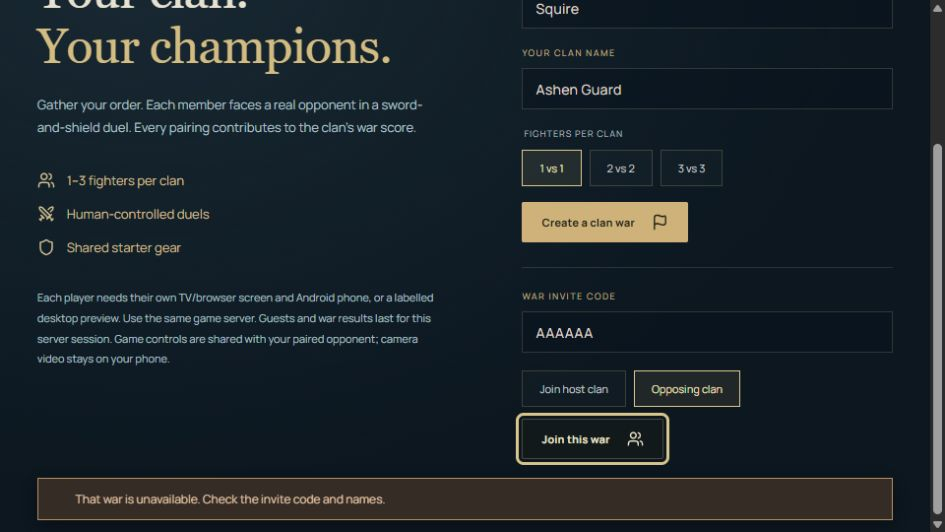

# Edge tests — 13 October 2026

Added 23 automated edge cases to the existing 89 tests. The complete suite now passes **112/112**, including the real two-client multiplayer relay test. TypeScript checking and the production build also pass.

## Failures reproduced and fixed

| Case | Before | Verified behavior |
| --- | --- | --- |
| Tracking loss and return between server ticks | An already queued sweep could remove 16 health after tracking returned. | Both stroke histories reset immediately; reacquisition starts from a fresh pose. |
| Pause/resume or reconnection between ticks | An in-flight strike could survive the interruption. | Pending strikes, guard timing and physical movement baselines reset at the transition. Reconnection accepts a fresh sequence. |
| TV disconnect immediately after an input | The duel could continue until the last input aged out. | Disconnect immediately holds both fighters and discards the queued action. |
| Leave a war, join a newer war, then expire the old one | Old-war cleanup could remove the player's newer membership. Expired clients also retained stale screens. | Cleanup checks which war owns each membership. Remaining clients receive an empty state and an expiry message. |
| Damaged pairing data or unavailable browser storage | An expiry-only saved object was accepted; a failed storage write prevented a valid pairing. | Codes, tokens, URL and expiry are validated. Pairing and renewal work when storage reads/writes/removal fail. Invalid server responses can be retried. Renewal ignores the old room even when deletion fails while reads still work. |
| Renew while an earlier pairing request is pending | The older response could overwrite the newly saved room. | Superseded responses cannot overwrite the current saved room or clear its request cache. |
| Zero or negative saved calibration ranges | Finite but invalid values could reach divisions in the motion engine. | Invalid profiles require recalibration; current and older valid profiles remain supported. |
| Extra fields nested in movement vectors | Arbitrary nested properties were copied into the opponent's snapshot, though they did not alter authoritative health or rewards. | Decoding copies only the expected coordinate fields. |
| Training frame gap | The cue said the view paused, but the tracked indicator and displayed angle remained stale. | The gap clears both indicators and resets the partial repetition. |
| Invalid invite on a scrolled TV-sized page | The error appeared above the visible viewport. | A visible notification explains the rejected invite without covering the focused Join button. |

## Additional edge coverage that passed

- A 3 vs 3 war resolves its three independent pairings, including a half-point draw, waits for all pairings and scores each result once. Late inputs cannot change the result.
- Malformed JSON, negative/fractional sequences, incomplete skeletons, invalid confidence, aspect and tracking metadata never reach the other TV. Valid traffic continues afterward.
- A burst of 46 packets disconnects only the offending phone with code 4408. The TV remains usable and a fresh phone can join.
- A 17 KB packet exceeds the 16 KB relay limit, closes with code 1009 and releases the phone slot without crashing the room.
- Replacing a TV preserves the connected phone; the retired TV's close event does not mark its replacement disconnected. Reconnecting a phone may restart its sequence at zero.
- Corrupted story, gear and training data return safe defaults. Invalid coins, XP and histories cannot grant rewards.
- Interrupted calibration requires a fresh continuous hold. Losing the calibrated side mid-rep cannot finish a rep using the other side. Invalid rest ticks and frames after completion cannot skip sets or add reps.
- Concurrent pairing requests reuse one session; a valid saved room avoids creating another room.

## Browser checks

Used the production build and real browser input at the normal viewport and at **960 × 540**, matching the logical viewport used by the existing Full HD TV emulator configuration.

- D-pad and Select reached Clan Wars, Training and the remote keyboard.
- Twenty-five rapid letter selections stopped at the fighter-name limit of 20. Back discarded the draft, preserved `Squire` and restored field focus. Down plus Select immediately opened the next field.
- Eight invite-code selections stopped at six characters. D-pad navigation reached Done, which stayed fully inside the 540-pixel viewport. Lowercase and punctuation input normalized to the expected uppercase code.
- An invalid invite produced useful feedback. After the visibility fix, the message occupied y=485–528 and the focused Join button y=425–466, both visible at 540 pixels high.
- Training without a camera held calibration at zero reps. Rapid pause toggles and Back did not add reps, sets or XP. Returning to the menu showed level 1 and zero training XP.



## Reproduction

```sh
npm test
npm run build
```

The local WebSocket tests require loopback network access. The pass used synthetic landmarks and mocked corrupted storage for deterministic edge coverage, alongside manual browser actions. This does not establish real-phone pose accuracy, exercise-form reliability, network latency or physical Fire TV performance. Native Java remote handling was unchanged in this pass; its earlier emulator checks are documented separately in `remote-controls-test-report.md`.
