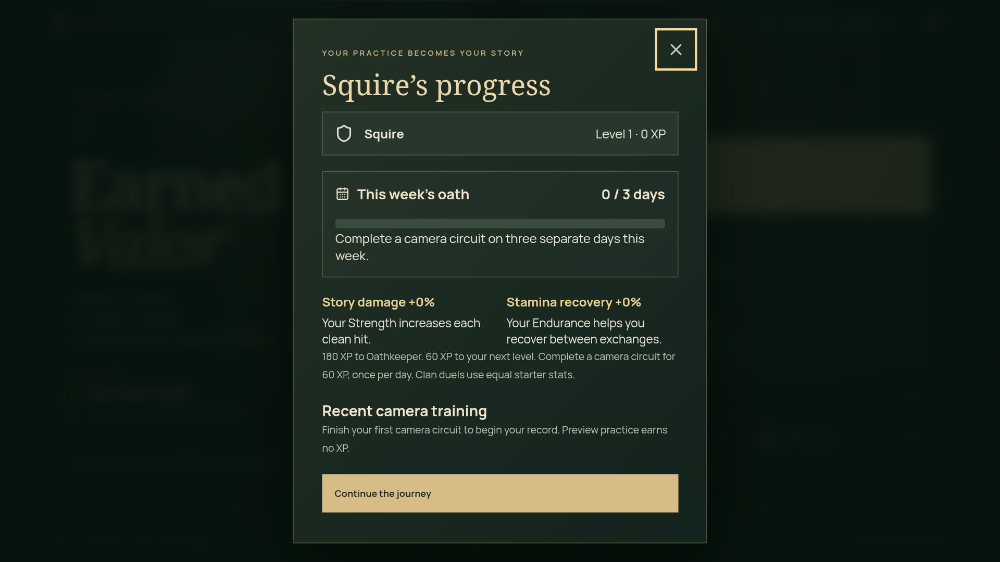
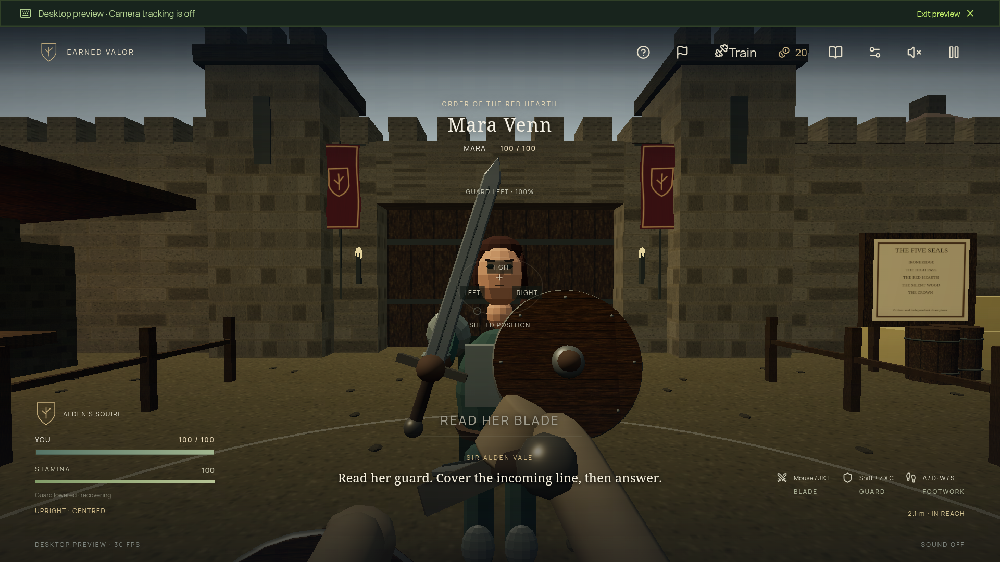

# Improvement and verification report

Verified locally on 14 October 2026. This report covers the implemented software improvements and the remaining device checks.

## Implemented changes

| Area | Result |
| --- | --- |
| Camera reliability | Inference faults immediately clear tracking and FPS. Recovery tries at most two fresh CPU processors, then releases the camera and offers restart. Old async startup, failure and cleanup callbacks cannot detach a replacement stream. Cancelling model startup terminates its worker. Hidden pages invalidate movement; wake locks are reacquired when the camera returns. |
| Phone responsiveness | Inference runs in a classic Web Worker with the pinned local MediaPipe runtime. Unsupported browsers have a CPU compatibility path. Phone UI updates are throttled; the TV app is loaded separately. The initial entry bundle decreased from 353.39 to 223.13 kB, or 111.33 to 70.02 kB gzip. |
| Pairing and calibration | Story and Training lead into their required setup. Phone connection, visible movement and TV receipt are shown separately. Wi-Fi QR pairing requires no USB cable. USB localhost remains an optional development connection. Exercise routines use their own side-view calibration. |
| TV performance | Auto graphics begin at a 1080p cap and lower to 720p after two sustained slow samples. Manual resolution choices remain fixed. Scene measurements expose the current quality and FPS. |
| Presentation | Mara has an original lightweight articulated figure, replacing the external Sentinel runtime model. The scene uses a more consistent palette. Larger captions and transient hit, block, parry and dodge feedback clarify combat. |
| Personal progression | Up to six local squires have separate story, gear, calibration and training saves. Original saves remain with the first squire. Progress shows three distinct practice days per week, ranks, recent camera circuits and bounded story bonuses. Preview practice earns no XP. |
| Clan persistence | Clan names, member names and server-completed war results persist in a bounded disk archive. Writes are serialized and atomic with a previous-file backup. Duplicate results and corrupt saves are handled. Active rooms and duels remain temporary. |
| Device rehearsal | Controller Setup includes a 30-second timing check, bounded summary download and a comparison with manually counted reps from the latest camera circuit. The report includes full-window tracking gaps, without raw poses or camera images. |
| Maintainability | Camera ownership, React camera lifecycle, inference, scene assets, profiles and persistence are separated into focused modules. GitHub Actions is configured for tests, production build, browser journeys and the Android APK. Optional Docker/Caddy hosting files preserve clan data and provide a trusted HTTPS route. |

## Verification

| Check | Result |
| --- | --- |
| `npm test` | **128 passed**, zero failed or skipped. Includes actual local relay integration, camera fault injection, calibration/combat/training rules, profiles, persistence recovery and graphics adaptation. |
| `npm run test:browser` | **10 passed** in installed Chrome. Covers remote navigation, real relay pairing/dropout traffic, profiles, scene rendering, actual worker inference on a blank video frame, replacement-camera cleanup, immediate worker cancellation, numeric remote entry and progress at TV density. |
| `npm run build` | **Passed**, including TypeScript checking. Lucide's existing module-directive warnings remain non-blocking. |
| `npm run android:build` | **Passed**. Debug package: `artifacts/EarnedValor-debug.apk`. |
| Native Android TV smoke check | **Passed** with the installed debug APK and built frontend: native D-pad, Select, Back, setup, progress, original 3D opponent and Play/Pause. Viewport was 1280 × 720 CSS pixels at 2× density. With the preview banner present, the scene buffer was 1920 × 1029; Auto retained its 1080p cap and the sampled FPS was 30. This is a smoke-test observation, not a physical-device benchmark. |
| Visual inspection | **Passed** for the native progress and combat screenshots below. Progress stays inside the TV viewport, its empty weekly bar renders correctly and the close control has remote focus. |
| `git diff --check` | **Passed**. |

The emulator updated its system WebView during the first native attempt and closed the app. The app was restarted and the complete native check above passed afterward. Native interaction used the explicitly labelled desktop preview, without a live phone camera.

## Remaining external validation

No physical Android phone or Fire TV was connected for this change. Live camera onboarding, human rep/strike accuracy, physical motion-to-display latency and hardware performance still require the [real-device playtest](../docs/DEVICE_PLAYTEST.md). Transport receipt timing does not establish physical latency; matching total rep counts alone does not establish individual-rep accuracy.

Wi-Fi pairing needs an HTTPS page trusted by the phone browser. Local development uses a self-signed certificate; a domain and hosting are optional for the hackathon. No domain was purchased and no service was deployed. Docker/public HTTPS files are prepared but have not been exercised against a real public deployment. CI is configured but has not been pushed or dispatched.

Recording the native demo, sharing repository access with judges and completing Devpost remain submission work. See [hackathon readiness](../docs/HACKATHON_READINESS.md).
