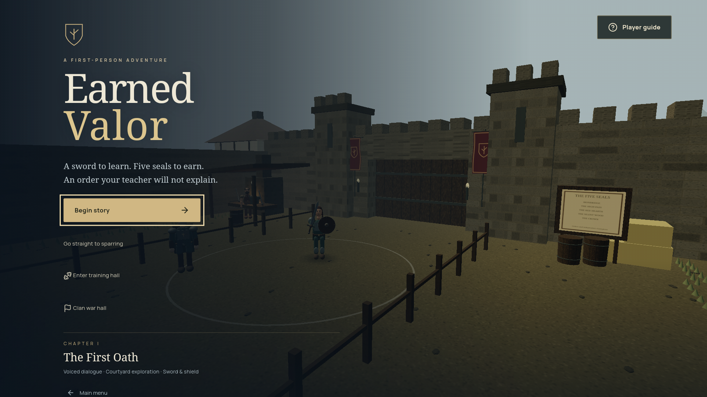

# Fresh repository setup verification

Verified 23 October 2026. Application and setup revision: `4cd91f65de14dbf9610943df66ccd80fc53a7beb`. [Clean GitHub Actions verification](https://github.com/dazai2001-cmd/Amazon-hackathon/actions/runs/39905234049) passed both jobs, including the production smoke check.

## Conditions

- Cloned the actual private GitHub repository into a new **Earned Valor** folder containing a space. No existing `node_modules`, `dist`, `.env`, WebView saves, certificates or prepared vision runtime were copied into it.
- Installed dependencies using the committed package lock with `npm ci`. Pose models came from the repository; the installation prepared the pinned runtime/WASM.
- Local host: Windows, Node 24.19.0, npm 11.17.0, JDK 17.0.20.1, Android SDK Platform 35 / Build-Tools 34.0.0 and Gradle 8.9. The SDK and JDK were supplied as documented external prerequisites through environment variables. The clone had no bundled SDK/JDK or Gradle cache; its native build downloaded Gradle and dependencies on first use.
- Created a separate, fresh **MoveRoomTV** AVD using TV 1080p / Android TV API 30 x86, and ran the clone's emulator helper with host graphics and GLES 3. Existing game saves/emulators were not cleared.
- Cloud verification used Node 22 and the installed Chrome on Ubuntu 24.04 for software/browser checks, plus a separate JDK 17 native APK build.

## Results

| Check | Result |
| --- | --- |
| `npm ci` from fresh GitHub clone | Passed; local camera tracking assets prepared |
| `npm test` | 128 tests passed, 0 failed |
| `npm run build` | TypeScript check and production bundle passed |
| `npm run test:production` | Five routes; built JS/CSS/artwork; both models/runtime/WASM; certificate-verified local HTTPS; authenticated HTTP/WSS pairing; synthetic pose and TV acknowledgement passed |
| `npm run test:browser` | 10 passed in 22.9 seconds from the clone |
| `npm run android:build` | Passed from the clone; first build completed in 1 minute 18 seconds and generated the documented APK |
| `npm start` | Started the clone's production server at the documented HTTP/HTTPS ports |
| Production browser menu | Loaded with the expected six menu options |
| `npm run android:run -- -Headless` | Booted fresh AVD, installed APK, configured ADB reverse for 8787 and loaded the native main menu |
| Chapter launch with `-ServerUrl http://127.0.0.1:8787/chapter` | Loaded the first-visit guide with the updated requirements; native Back closed it and exposed the rendered 3D courtyard |
| USB helper SDK lookup | Located ADB using `ANDROID_SDK_ROOT` without requiring ADB on PATH; an intentionally nonexistent serial returned the expected phone authorization/setup instructions |
| Missing-AVD handling | An intentionally nonexistent AVD exited promptly with Device Manager/name instructions |
| Guide/file links and PowerShell syntax | Checked successfully |

The production smoke check uses synthetic landmarks and isolated generated server data. No real phone was connected for this reproduction; existing submission phone-testing status is unchanged. This verification does not claim physical Fire TV performance, human exercise accuracy or a live two-phone multiplayer benchmark. macOS manual native commands are documented; no macOS emulator run was performed.

The temporary server and emulator were stopped after verification.

## Native evidence

[Fresh-clone main menu](reviewer-native-menu.png) · [First-visit guide and requirements](reviewer-native-chapter.png)

Follow [the reviewer setup guide](../docs/REVIEWER_GUIDE.md) to reproduce these steps. The [workflow](../.github/workflows/verify.yml) runs the software, production, browser and APK checks for subsequent code changes.
